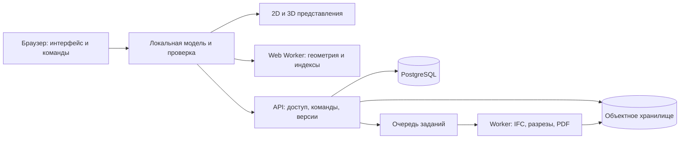

# План разработки архитектурной веб-САПР на основе анализа Archicad

Дата исследования: **18 ноября 2026 года**.

## 1. Направление продукта

Под САПР здесь понимается **система автоматизированного проектирования зданий**, поскольку основной указанный аналог — Archicad. Управление производством, станками и цеховыми заданиями относится к другому направлению — MES/ERP/CAM. Если исходная цель именно производственная, предметную модель и дорожную карту нужно изменить до разработки.

**Предлагаемый продукт:** браузерная BIM-система для небольших архитектурных бюро, проектирующих малоэтажные жилые и небольшие общественные здания. BIM — это модель здания, в которой стены, перекрытия и окна имеют геометрию, свойства и связи.

Основная идея: **одна модель здания → согласованные планы, 3D, разрезы и ведомости → проверенный выпуск документации**.

Первый пользовательский сценарий:

> Архитектор создаёт проект и этажи → строит стены и перекрытия → размещает двери и окна → проверяет 3D и площади помещений → формирует план и разрез → получает замечания → выпускает выбранную редакцию в PDF и IFC.

Исходные допущения для оценки: настольный браузер, мышь и клавиатура; русскоязычный интерфейс; здание до четырёх этажей; пилот с 2–3 бюро; одна организация на пилотном развёртывании. Эти ограничения являются предложением, которое проверяется на этапе исследования пользователей.

## 2. Анализ аналогов

Анализ основан на официальных страницах и документации. Практическое тестирование программ, проверка лицензий на конкретное внедрение и сравнительные замеры не проводились. Возможности разных редакций и тарифов могут отличаться.

| Аналог | Подтверждённые возможности | Что использовать в своём продукте |
|---|---|---|
| **Archicad** | Архитектурные BIM-инструменты, работа со стенами, окнами и кровлями, документация и OpenBIM | Строительные объекты вместо набора несвязанных линий; единая модель проекта. [Официальный обзор](https://www.graphisoft.com/en-pl/plans-and-products/archicad/) |
| **Archicad: виды и ведомости** | Навигатор этажей, разрезов, фасадов, 3D и ведомостей; размещение сохранённых видов на листах; ведомости по данным модели | Разделять модель, настройки видов и листы; получать площади и состав элементов из модели. [Навигатор](https://help.graphisoft.com/AC/29/INT/_AC29_Help/030_Interaction/030_Interaction-4.htm), [ведомости](https://help.graphisoft.com/AC/29/INT/_AC29_Help/055_InteractiveSchedule/055_InteractiveSchedule-1.htm) |
| **BIMcloud / Teamwork** | Совместная работа Archicad с резервированием элементов; передача изменений; браузерное администрирование | Явная принадлежность редактируемых данных и контроль конфликтов. Это облачная совместная работа настольного редактора. [BIMcloud](https://www.graphisoft.com/en-se/plans-and-products/bimcloud/), [Teamwork](https://help.graphisoft.com/AC/29/INT/_AC29_Help/080_Collaboration/080_Collaboration-3.htm) |
| **BIMx** | Связанные листы, 3D-модель и BIM-данные; просмотр на разных устройствах, включая веб | Упрощённый просмотр проекта и документации для заказчика. [BIMx](https://www.graphisoft.com/en-pl/plans-and-products/bimx/) |
| **Autodesk Revit** | Параметрические элементы, листы, ведомости, ревизии, совместная работа, IFC и API | Ссылочные размеры, управляемые зависимости и история выпуска. [Возможности Revit](https://www.autodesk.com/ae/products/revit/features) |
| **Snaptrude** | Браузерная платформа: объёмное проектирование, BIM, площади, совместная работа, комментарии и презентационные листы | Основной ориентир для браузерного взаимодействия и быстрого перехода от идеи к модели. [Руководство](https://help.snaptrude.com/en/articles/17761283-getting-started-with-snaptrude) |
| **Floorplanner** | Онлайн-планы помещений, стены, двери и окна, 3D-представление, библиотека объектов | Низкий порог входа, понятное редактирование плана, готовые объекты. Это ориентир для UX планировщика; профессиональную BIM-совместимость нужно оценивать отдельно. [Официальный обзор](https://floorplanner.com/) |

### Практические выводы

1. **Основа — семантическая модель.** Стена хранит ось, высоту, толщину, материал и связи с проёмами; её изображение на плане и в 3D вычисляется.
2. **Документация — часть редактора.** Сохранённые виды, размеры и ведомости нужно проектировать вместе с моделью.
3. **Для веба важен законченный короткий сценарий.** Быстро открыть проект, внести точное изменение и поделиться конкретной версией.
4. **Обмен — отдельная инженерная задача.** Импорт, просмотр и полноценное параметрическое редактирование чужой модели имеют разную сложность.
5. **Гипотеза преимущества:** малому бюро может быть полезен простой веб-инструмент с качественными планами, доступом для заказчика и открытым обменом. Эту гипотезу должны подтвердить интервью и пилот; браузер и совместная работа уже есть у конкурентов.

## 3. Пользователи и проверка спроса

| Роль | Основные действия |
|---|---|
| Архитектор | Создаёт и редактирует модель, оформляет виды и листы |
| Ведущий архитектор | Проверяет проект, назначает замечания, фиксирует выпуск |
| Заказчик / наблюдатель | Просматривает разрешённую редакцию, оставляет комментарии |
| Администратор | Управляет доступом, шаблонами, хранением и резервными копиями |

На старте провести 8–12 интервью, разобрать минимум 5 реальных проектов и наблюдать выполнение 3 типовых задач. Измерить затраты времени, частоту исправлений и обязательные форматы обмена. Проверить готовность бюро использовать продукт на реальном проекте и платить за него.

Результат исследования: целевой сегмент, один основной сценарий, контрольные модели, перечень обязательных функций и критерии успешного пилота. Условия размещения, автономной работы и обязательность DWG фиксируются до выбора инфраструктуры.

## 4. Состав первой версии — P0

| Модуль | Объём для пилота |
|---|---|
| Проекты и доступ | Создание проекта, участники, роли, список проектов, единицы измерения, история сохранений |
| Этажи и координаты | Этажи с отметками и высотами, строительные оси, локальная система координат, настройка сетки |
| Точный 2D-редактор | Выделение, перемещение, копирование, поворот, удаление, числовой ввод, привязки, ортогональный режим, отмена/повтор |
| Стены | Прямые вертикальные стены постоянной толщины, высота и базовый уровень; согласованный набор L/T/X-сопряжений |
| Перекрытия и кровля | Горизонтальные полигональные плиты; простая плоская кровля. Отверстия — в пределах проверенных типов геометрии |
| Проёмы | Параметрические двери и окна в стене; зависимость от стены, ширина, высота, отметка и направление открывания |
| Помещения | Создание зоны по замкнутому контуру с проверкой; номер, название, площадь по явно заданным правилам; ручная корректировка контура |
| Библиотека | Небольшой набор собственных параметрических дверей/окон и объектов обстановки; тип и экземпляр разделены |
| 3D | Орбита, панорама, масштабирование, выбор, скрытие категорий, материалы, плоскость отсечения |
| Документация | План этажа, простой вертикальный разрез и фасад для поддерживаемой геометрии; размеры, марки, текст, масштаб, базовый лист |
| Ведомости | Помещения, двери и окна; простые количества и объёмы с описанием правил вычитания проёмов |
| Обмен | PDF листов, CSV ведомостей, IFC4 для согласованного подмножества классов; IFC-референс для просмотра и координации |
| Проверка и выпуск | Замечания к объекту/виду, статусы, журнал, неизменяемая редакция выпуска с PDF/IFC |
| Надёжность | Автосохранение, индикатор подтверждённого сохранения, восстановление после сбоя, резервное копирование |

**Контрольный пример:** двухэтажный дом с внутренними перегородками, 20 помещениями и 50 дверями/окнами. Изменение положения стены должно обновить связанные проёмы, виды, размеры и затронутые площади либо явно показать, какие связи требуют исправления.

Для P0 редактирование проекта выполняет один пользователь в момент времени; другие могут просматривать сохранённые версии и комментировать. Блокировка редактора действует и между двумя вкладками одного пользователя. Одновременное редактирование разных объектов — отдельный следующий этап.

### P1 — после проверки пилота

- Скатные кровли, многослойные стены и перекрытия, колонны, балки, параметрические лестницы.
- Расширенные сопряжения, сложные контуры, улучшенные разрезы и скрытые линии.
- Совместное редактирование с резервированием объектов и атомарных групп зависимостей.
- DXF-подложки и экспорт; DWG после подтверждения спроса и выбора SDK.
- Сравнение редакций, обмен замечаниями BCF, шаблоны бюро, расширенные ведомости.
- Формализованное покрытие согласованного набора требований СПДС; корпоративный вход и развёртывание у заказчика по спросу.

### P2 — отдельные продуктовые направления

Инженерные системы MEP, расчёт конструкций, подробная смета, территория и геодезия, сложные фасады, алгоритмическое моделирование, фотореалистичный рендер, мобильное редактирование и AI-помощник. Для каждого направления нужны отдельные требования, специалисты и оценка. AI может предлагать изменения через проверяемые команды модели с предварительным просмотром и отменой.

## 5. Интерфейс и основные экраны

1. **Панель проектов:** проекты, последние редакции, участники и шаблоны.
2. **Редактор:** слева инструменты и дерево этажей/видов; в центре план или 3D; справа свойства выбранного объекта; снизу координаты, привязки и состояние сохранения.
3. **Виды и листы:** сохранённый масштаб, диапазон видимости, оформление, размещение на листе и экспорт.
4. **Ведомости:** фильтрация элементов и переход из строки таблицы к объекту модели.
5. **Проверка:** комментарии с камерой/видом и привязкой к элементу, ответственный, статус.

Сначала проверить кликабельный прототип на 5–6 архитекторах. Основные инструменты должны поддерживать клавиатуру, числовой ввод, отмену и понятное завершение команды. План и 3D используют общий механизм выбора и стабильные идентификаторы объектов.

## 6. Предлагаемая архитектура

Начальный вариант — модульный backend и отдельные процессы геометрии/экспорта. Это позволяет изолировать тяжёлые задачи и сохранить управляемость разработки.

| Слой | Предлагаемый выбор | Для чего |
|---|---|---|
| Клиент | TypeScript, React, Vite | Интерфейс, инструменты, свойства, навигация |
| Отображение | Three.js; SVG для аннотаций/листов; окончательный вариант 2D — после замеров | Общий выбор объектов и камеры, удобное оформление |
| Ядро модели | Собственный TypeScript-пакет без зависимости от UI | Типы, команды, связи, правила, undo/redo |
| Вычисления | Web Workers; WASM при подтверждённой необходимости | Перестроение без блокировки интерфейса |
| Backend | TypeScript / NestJS; REST, WebSocket для уведомлений | Права, проекты, версии, задания, аудит |
| Данные | PostgreSQL; JSONB для расширяемых параметров | Сущности, связи, ревизии, транзакции |
| Файлы | S3-совместимое хранилище | Исходные IFC, снимки модели, PDF и результаты заданий |
| Геометрия/IFC | Отдельный Python-worker с IfcOpenShell | Чтение/запись IFC, обработка геометрии, проверка обмена |
| Эксплуатация | Контейнеры, CI, логи, метрики, трассировка | Воспроизводимый выпуск и диагностика |

Three.js предлагает средства 3D-отображения; BIM-семантику, сопряжения, размеры и документацию нужно реализовать отдельно. That Open / web-ifc — кандидаты для ускорения IFC-просмотра, а не готовая предметная модель редактора. IfcOpenShell предоставляет инструменты работы с IFC и геометрией. Окончательный набор библиотек, их версии и зависимости фиксируются после прототипа. [Three.js](https://threejs.org/docs/), [That Open](https://docs.thatopen.com/intro), [web-ifc](https://github.com/ThatOpen/engine_web-ifc), [IfcOpenShell](https://docs.ifcopenshell.org/).

В реестр зависимостей включить условия лицензий каждого выбранного пакета и ассета. У web-ifc указана MPL-2.0; репозиторий IfcOpenShell содержит компоненты с разными лицензиями, поэтому проверка должна относиться к конкретному используемому компоненту. [web-ifc: репозиторий](https://github.com/ThatOpen/engine_web-ifc), [IfcOpenShell: репозиторий](https://github.com/IfcOpenShell/IfcOpenShell).

## 7. Модель данных и корректность изменений

Основные сущности:

- `Organization`, `User`, `Project`, `Membership` — организация и доступ.
- `Site`, `Building`, `Storey` — пространственная структура.
- `ElementType`, `Element`, `Material`, `PropertySet` — типы, экземпляры, материалы и свойства.
- `HostRelation`, `Connection`, `SpaceBoundary` — проёмы в стенах, соединения, границы помещений.
- `View`, `Annotation`, `Sheet`, `ScheduleDefinition` — виды и документация.
- `Revision`, `Command`, `Issue`, `Release`, `ExportJob` — история, замечания и выпуск.

У элемента: стабильный UUID, класс, ссылка на тип, этаж, локальное преобразование, параметры, свойства и версия. Параметры стены — исходные данные; mesh и линии видов — пересчитываемый кэш с указанием версии алгоритма.

Правила реализации:

1. Одна внутренняя единица длины — метр; отображение в миллиметрах/метрах по настройке. Расчёты в double precision; точность интерфейса и геометрический допуск задаются отдельно.
2. Строительная модель хранится в локальных координатах; геопривязка — отдельное преобразование. Большие мировые координаты не передаются напрямую в рендер без проверки точности.
3. Изменения проходят через команды: `CreateWall`, `MoveWall`, `InsertOpening`, `SetStoreyHeight`. Команда содержит ID, базовую ревизию и атомарную группу изменений; сервер повторно проверяет инварианты.
4. Перенос стены обновляет её проёмы; удаление стены требует определённого правила для зависимых объектов. Изменения уровня учитывают элементы с привязкой к нему.
5. Размеры ссылаются на устойчивые признаки элемента, а не номера треугольников mesh. При утрате ссылки размер помечается как требующий исправления.
6. Зависимые виды и ведомости помечаются устаревшими и перестраиваются. До завершения пересчёта выпуск блокируется; пользователь видит состояние.
7. Undo/redo проверяется на связанных операциях. Сервер обеспечивает идемпотентность команды и отказ при устаревшей базовой версии. Снимки ускоряют открытие; журнал помогает восстанавливать изменения.
8. Выпуск использует один неизменяемый снимок модели и настройки видов; PDF, IFC и ведомости получают одинаковый номер ревизии.

## 8. Геометрия, виды и документация

Геометрическое ядро должно решать построение стен, L/T/X-узлы, размещение проёмов, плиты, сечения и вычисление площадей. Перед основной разработкой составить набор эталонов: почти параллельные стены, короткие сегменты, тонкие элементы, совпадающие грани, отверстия у края, самопересечения и вырожденные контуры.

Для P0 ограничиться аналитически описываемыми прямыми стенами и экструзиями. Прототип сравнивает специализированные алгоритмы и библиотечное геометрическое ядро. Если выбранный подход не обеспечивает стабильные проёмы и сечения, пересмотреть ядро и сроки в конце прототипа.

**План этажа** строится по отметке сечения и диапазону отображения; **разрез** — по заданной плоскости и глубине; **фасад** — по направлению проекции. Сечения mesh для экранного просмотра и векторный чертёж для выпуска — разные результаты. Для P0 зафиксировать ограничения скрытых линий и оформления.

PDF формируется из векторного представления листа с масштабом, толщинами линий и встроенными разрешёнными шрифтами. Проверить печать контрольного размера, кириллицу, штриховки и поля. Шаблоны документации и перечень применимых требований СПДС согласовать с профильным специалистом; полноту нормативного оформления не заявлять без проверки.

## 9. Обмен с другими системами

IFC — открытая модель обмена данными о строительных объектах, включая их свойства и отношения. [buildingSMART: IFC](https://technical.buildingsmart.org/standards/ifc/).

| Формат | План поддержки |
|---|---|
| Собственный формат | Версионируемая схема проекта, параметры, связи, виды и история; миграции между версиями |
| IFC4, P0 | Экспорт согласованных классов: пространственная структура, стены, плиты, двери, окна, проёмы и помещения; профиль/представления согласовать с принимающими системами |
| IFC-импорт, P0 | Изолированная референсная модель: просмотр, свойства, скрытие, измерение; исходный файл сохраняется |
| IFC-редактирование, P1+ | Конвертация выбранных классов в собственные объекты с отчётом об ограничениях; неизвестная геометрия остаётся референсом |
| PDF / CSV, P0 | Листы и табличные данные из одной ревизии |
| DWG / DXF, P1 | Отдельный прототип импорта/экспорта и проверка SDK, шрифтов, единиц, слоёв и листов |
| PLN / RVT | Прямая поддержка не входит в оценку; первоначальный обмен через IFC, документацию и подложки |

Для каждого формата составить матрицу «читаем / показываем / редактируем / экспортируем». Параметрическую историю и библиотечное поведение исходной системы нельзя считать восстановленными только по успешному просмотру IFC.

Минимальный набор обмена — 15–20 разнообразных файлов, включая экспорт из Archicad и Revit. Проверять классы, GUID, единицы, размещения, проёмы, свойства и количества. Повторный импорт собственного экспорта дополнить проверкой в независимом просмотрщике и целевых авторских системах; фиксировать настройки и версии.

## 10. Сохранение, доступ и совместная работа

P0 использует аренду блокировки проекта с heartbeat и серверным токеном поколения: команды от прежнего владельца после истечения аренды отклоняются. Это защищает от изменений в зависшей вкладке. Просмотрщики получают подтверждённые версии.

Автосохранение выполняется после команд с короткой задержкой; локально хранится очередь неподтверждённых изменений. При потере сети пользователь видит статус; после смены базовой ревизии требуется явное восстановление черновика. Полноценное конкурентное офлайн-редактирование — отдельная задача.

P1 добавляет резервирование элементов и связанных групп, серверный порядок команд, версии объектов и обработку конфликтов. Для комментариев можно отдельно оценить CRDT; геометрические изменения должны сохранять предметные инварианты.

Права проверяются сервером для каждой операции и скачивания файла. Ссылки просмотра имеют ограниченный доступ и срок действия. Импорт и экспорт запускаются с лимитами размера, памяти и времени. Для пилота предусмотреть резервные копии БД и файлов и реальную проверку восстановления; параметры RPO/RTO согласовать с заказчиком.

## 11. Дорожная карта

**Предварительный ориентир: 40–48 недель до пилотной P0**, включая резерв, при команде с опытом CAD/BIM. Это инженерная оценка предложенного объёма. После прототипа сроки и состав пересчитываются. Интерактивный демонстратор можно выделить на 8–12 недель, сократив его до прямых стен, проёмов, 2D/3D и сохранения.

| Этап | Недели от старта | Основная работа | Проверяемый результат |
|---|---|---|---|
| 1. Исследование | 1–3 | Интервью, реальные проекты, форматы, размещение, перечень P0 | Согласованный сценарий и критерии пилота |
| 2. Прототип рисков | 4–8 | Стены и узлы, проёмы, сечение, PDF в масштабе, IFC, производительность | Эталонные примеры; выбор ядра; решение продолжать или менять объём |
| 3. Основа продукта | 9–12 | Проекты, роли, схема модели, команды, ревизии, CI и хранение | Проект сохраняется и восстанавливается без потери связей |
| 4. Редактор модели | 13–22 | Этажи, оси, стены, плиты, проёмы, точность, undo/redo, 3D | Контрольный двухэтажный дом редактируется целиком |
| 5. Документация и обмен | 23–30 | Помещения, виды, размеры, ведомости, листы, IFC/PDF | Из одной модели выпущен проверяемый комплект |
| 6. Подготовка пилота | 31–34 | Комментарии, выпуск, доступ, восстановление, оптимизация | Полный маршрут архитектор → проверка → выпуск |
| 7. Пилот | 35–40 | Реальные задания в 2–3 бюро, измерения, исправления, инструкции | Протокол приёмки и приоритеты P1 |
| Резерв | 41–48 при необходимости | Риски геометрии, форматов, качества и внедрения | Завершение согласованного P0 |

Проверки и демонстрации идут на всех этапах. Критическая зависимость: ядро модели → устойчивые связи и геометрия → виды и ведомости → проверенный выпуск. Проверку IFC и PDF начать на этапе 2, чтобы не обнаружить ограничения выбранной модели в конце проекта.

## 12. Команда и бюджет

Рекомендуемый состав: технический руководитель с опытом вычислительной геометрии; 2 frontend-разработчика, включая специалиста по графике; 1 backend-разработчик; 1 разработчик геометрии/IFC; 1 QA-инженер. Product/аналитик, UX-дизайнер и DevOps — частичная загрузка. Архитектор/BIM-специалист участвует в еженедельной приёмке.

Ориентир трудозатрат — **60–80 человеко-месяцев** для P0 с пилотом и резервом. Диапазон зависит от загрузки команды, повторного использования библиотек и результатов прототипа; верхние границы численности, срока и трудозатрат не следует механически перемножать.

Бюджет рассчитывается по полной стоимости человеко-месяца команды плюс инфраструктура, лицензии/SDK, ассеты, внешняя экспертиза и внедрение. Рыночные ставки и коммерческие предложения в этом исследовании не собирались. Резерв уже включён в приведённые ориентиры; его не нужно учитывать второй раз. P1/P2 и постоянная поддержка оцениваются отдельно.

Для одного разработчика или учебного проекта следует выбрать демонстрационный объём: стены и проёмы, 2D/3D, этажи, свойства и сохранение. Сроки демонстратора не являются оценкой готовой профессиональной САПР.

## 13. Проверки и критерии приёмки

Числа ниже — предлагаемые цели, а не результаты замеров. На этапе прототипа фиксируются браузеры, оборудование, сеть и контрольные модели.

| Область | Критерий |
|---|---|
| Сквозной сценарий | Контрольное здание создаётся, изменяется, проверяется и выпускается без ручного восстановления данных между видами |
| Связность | Изменение стены/этажа обновляет зависимости; неразрешённые связи видимы и блокируют выпуск |
| Геометрия | Эталонные L/T/X-узлы, проёмы и сечения проходят численные и визуальные проверки; допуск фиксируется по масштабу модели |
| Undo/redo | Последовательность связанных команд и отмен возвращает эквивалентную модель и связи |
| Производительность | На модели до 10 000 собственных элементов — не менее 30 FPS при навигации и p95 отклика выбора до 100 мс в согласованной среде; лимиты треугольников и объектов библиотеки измеряются отдельно |
| Открытие | Снимок контрольной модели до 25 МБ открывается до 10 секунд в согласованной сети; ожидание импорта показывается отдельно |
| Сохранение | После перезагрузки восстанавливаются все подтверждённые сервером команды; неподтверждённые операции явно обозначены |
| Документация | Проверены масштаб PDF, кириллица, марки, размеры, листы и совпадение ревизий |
| IFC | Все поддерживаемые объекты контрольного корпуса сохраняют согласованные классы, GUID, размещения и свойства; ограничения отражены в отчёте |
| Доступ | Проверены роли, запрет доступа к чужому проекту/файлу, отзыв доступа и истечение блокировки |
| Восстановление | Проект и выпущенные файлы восстановлены из резервной копии на отдельном окружении |
| Пользовательская ценность | Не менее 4 из 5 пилотных архитекторов завершают основной сценарий; время выполнения и объём исправлений сравниваются с исходным процессом |

Тестирование: unit/property-based проверки геометрии и команд; интеграционные проверки сохранения и обмена; браузерные сквозные сценарии; визуальные эталоны видов и PDF; нагрузочные прогоны на разных по структуре моделях. Самый важный набор регрессии — изменения проекта с сохранением связности документации.

## 14. Главные риски и решения

| Риск | Действие до основной разработки |
|---|---|
| Геометрия нестабильна на реальных проектах | Эталонные сложные узлы на этапе 2; ограничение поддерживаемых конструкций; возможность заменить ядро |
| Разные результаты на плане, в 3D и ведомостях | Единая модель, зависимости, версии кэшей, блокировка выпуска при устаревших результатах |
| IFC выглядит верно, но теряет смысл | Матрица классов/свойств, проверка отношений и независимый контроль экспорта |
| Пользователям обязательны DWG или нативные библиотеки | Выяснить на интервью; отдельно оценить SDK и конвертацию до обещаний пилота |
| Модель перегружает браузер | Ранние замеры, пространственные индексы, инстансинг, уменьшение детализации, workers и порционная загрузка |
| Конкурентные изменения нарушают связи | Один редактор в P0; атомарные группы и серверные версии в P1 |
| Расширение объёма срывает выпуск | Зафиксировать P0 и критерии; новые направления оценивать отдельно |
| Продукт не даёт бюро достаточной выгоды | Пилот на реальных задачах, сравнение времени и готовности платить до расширения функциональности |

## 15. Первые действия после принятия направления

1. Подтвердить целевой сегмент, тип здания и основной сценарий.
2. Собрать реальные проекты, требования к размещению и форматам, назначить BIM-эксперта для приёмки.
3. Описать модель стены, этажа, проёма, вида и ревизии; зафиксировать единицы, команды и правила связей.
4. Подготовить прототип экрана и набор геометрических/обменных эталонов.
5. Запустить технический прототип: построить стены и проём → получить план, 3D и сечение → сохранить → экспортировать IFC/PDF → проверить в другой системе.
6. По результатам прототипа зафиксировать архитектуру, зависимости, P0, сроки, бюджет и измеримые критерии пилота.

Практическая цель первого этапа разработки — доказать корректность изменения единой модели и получения документации. Именно этот результат определяет пригодность основы для дальнейшей архитектурной САПР.
