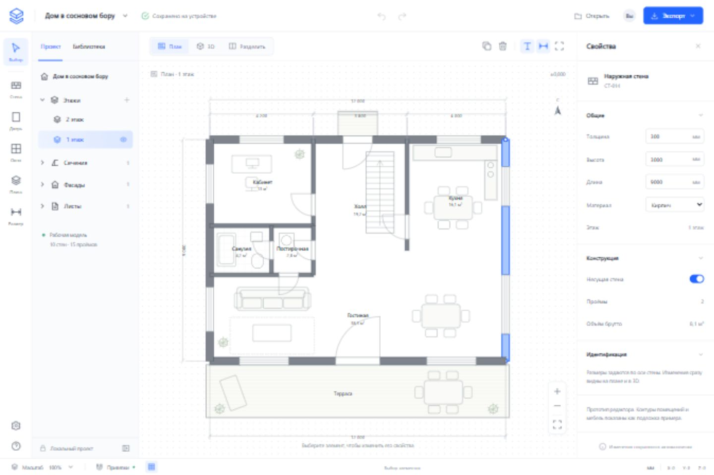
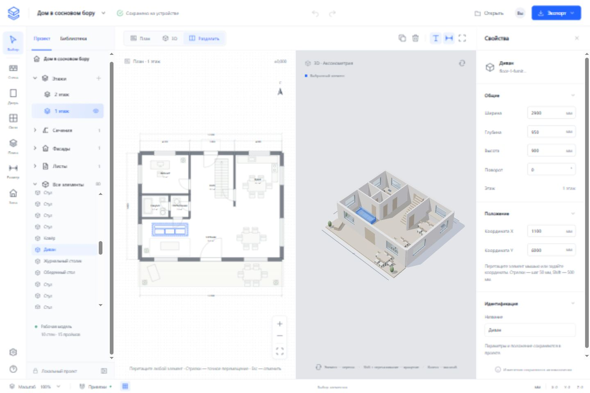

# Проверка первой версии

Дата: 18 ноября 2026 года.

## Автоматические проверки

`node --test`: 7 проверок успешно. Покрыты сохранение структуры проекта при JSON-обмене, исключение проёмов из сегментов стен, ограничения размещения проёмов, некорректные/дублирующиеся данные, проекция на стену, площадь контура и экранирование текста в SVG.

Синтаксис `app.js`, `plan.js`, `scene.js`, `icons.js` проверен через `node --check`. GitHub Actions проверил модель и опубликовал приложение.

## Проверено в браузере

- Начальная загрузка страницы без текстового названия системы; логотип сохранён.
- Изменение толщины стены с 300 до 400 мм клавиатурой; обновление объёма и доступность отмены.
- Отмена изменения, сохранение и повторное открытие страницы.
- Построение дополнительной стены; размещение окна на ней; появление связанных параметров проёма.
- Отмена добавления проёма и стены; восстановление исходного числа элементов.
- Переключение первого/второго этажа и обновление отметки уровня.
- План, 3D и разделённый экран; отсутствие ошибок/предупреждений в консоли при проверке опубликованной страницы.
- Скачивание JSON; файл прочитан, подтверждены версия схемы 1, два этажа и исходная толщина 300 мм.
- Компоновка на ширине 1440, 714 и 390 пикселей.
- Публичный сайт открывается по https://roman33r.github.io/BIM/.

Печать/PDF и импорт через системный диалог в этом браузерном прогоне не проверялись. Код проверки импортируемых данных покрыт автоматическими тестами.

## Обновление: перемещение элементов и новые проекты

Автоматические проверки: **17 успешно**. Добавлены проверки пустого проекта, доступности каждого элемента для выбора на плане, переноса стены с сохранением её проёмов, ограничений движения окон, перемещения мебели/помещений/плит/размеров, миграции старых файлов, независимости проектов в каталоге и сохранности данных при переполнении хранилища. Границы вписывания/экспорта учитывают объекты, перенесённые за исходный контур здания.

В браузере проверены:

- Перетаскивание дивана: X 1100 → 2400 мм, Y 6000 → 6950 мм; одно нажатие отмены возвращает обе координаты.
- Выбор размера из списка и перенос стрелкой вправо на 50 мм без изменения измеряемой длины.
- Изменение X помещения с 150 до 650 мм через свойства и отмена изменения.
- Создание отдельного пустого проекта без мебели, стен и обозначений из примера.
- Построение стены и окна в новом проекте, перенос стены на плане вместе с окном.
- Перенос той же стены непосредственно в 3D, обновление координат в свойствах.
- Перезагрузка страницы с сохранением активного нового проекта; список двух проектов и возвращение к исходному дому.
- Единое выделение дивана на плане и в 3D; сохранение выбранного элемента при смене вида.

